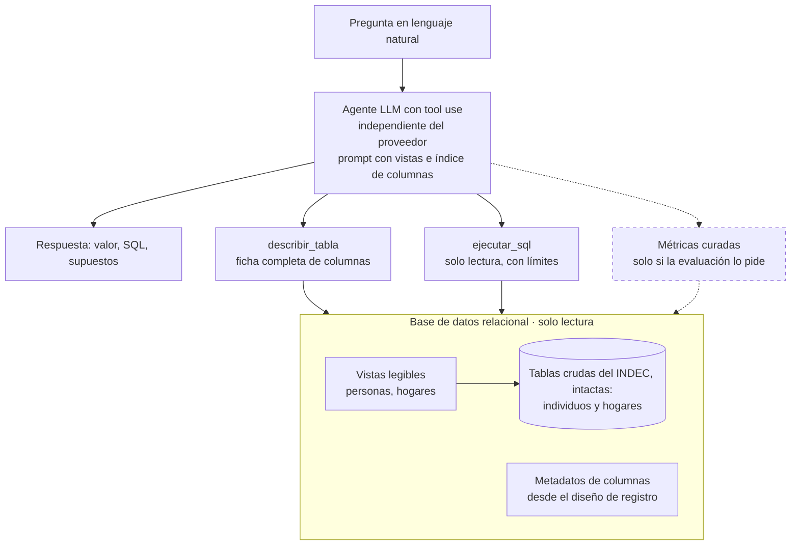
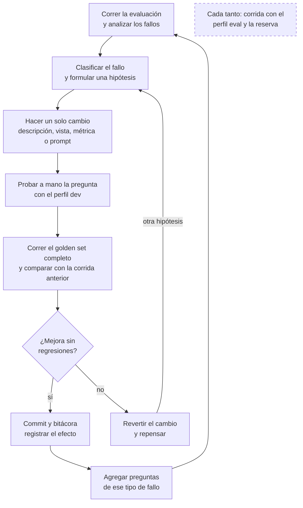

# Agente de consultas en lenguaje natural sobre la EPH

Oct 23, 2026 · @Damian

Este documento presenta un agente que responde preguntas en lenguaje natural sobre los microdatos de la Encuesta Permanente de Hogares (EPH) del INDEC: arma el SQL, lo ejecuta sobre una base de datos relacional y devuelve la respuesta con el SQL y los supuestos que usó. El alcance inicial es un único trimestre, el primero de 2026 (1T 2026), que es el último publicado al momento de implementar esto; sumar otros trimestres y la integración por MCP con asistentes basados en LLM quedan como mejoras futuras.

El documento cumple tres funciones: compartir la propuesta, guiar el desarrollo (el plan de trabajo del final se va tildando) y documentar cómo funciona el producto terminado. Se actualiza a medida que avanza el proyecto; el detalle de cada decisión queda en la bitácora del repositorio.

## Objetivo

Un agente desplegado en la nube que responda con precisión preguntas sobre mercado laboral e ingresos, por ejemplo *“¿cuál fue la tasa de desocupación de las mujeres en Gran Córdoba en el 1T 2026?”*.

Cada respuesta incluye:

- el valor o la tabla resultante,
- el SQL ejecutado, para que sea auditable,
- los supuestos tomados (qué variable de ingreso, qué período),
- advertencias cuando la muestra es chica y la estimación es poco confiable.

El criterio de éxito es medible: un porcentaje de acierto sobre un golden set de preguntas con respuesta conocida, validadas contra los informes oficiales del INDEC cuando existen.

## Datos

Usamos la **EPH continua**: trimestral, 31 aglomerados urbanos, microdatos publicados desde el 2T 2016 en dos tablas (individuos y hogares). El alcance inicial usa un único trimestre, el primero de 2026 (1T 2026), que es el último publicado al momento de implementar esto.

Los microdatos se descargan de la [página de bases de datos del INDEC](https://www.indec.gob.ar/indec/web/Institucional-Indec-BasesDeDatos) y se cargan en una **base de datos relacional**. Las tablas de individuos y hogares quedan tal como las publica el INDEC, y sobre ellas se construye la capa semántica.

### Primera iteración en Google Colab

El notebook [`notebooks/eph_1t2026_sqlite.ipynb`](notebooks/eph_1t2026_sqlite.ipynb) descarga el ZIP oficial, verifica su huella SHA-256 y construye SQLite por lotes. Permite filtrar por aglomerado y seleccionar columnas sin cargar toda la base en memoria; cada ejecución genera además un manifiesto con la fuente, filtros, esquema y conteos. El modo predeterminado conserva todas las filas y columnas.

[Abrir el notebook en Google Colab](https://colab.research.google.com/github/d-montenegro/eph-agente/blob/main/notebooks/eph_1t2026_sqlite.ipynb)

## Capa semántica

Las tablas del INDEC usan nombres de columnas y valores codificados: por ejemplo, el sexo está en la columna `CH04`, con 1 = varón y 2 = mujer. Sin contexto, un modelo no puede interpretarlos. Por eso, sobre las tablas se crean **vistas** con nombres y valores legibles, acompañadas de **metadatos** que describen cada columna; el agente trabaja solo con esas vistas y los metadatos, no con las tablas crudas.

Los metadatos forman el diccionario de datos: para cada columna, qué significa, qué valores toma, a quién aplica y con qué ponderador se estima. El agente lo consulta para decidir qué columnas usar y cómo. El diccionario se arma con el [Diseño de registros y estructura para las bases preliminares Hogar y Personas](https://www.indec.gob.ar/ftp/cuadros/menusuperior/eph/EPH_registro_1T2026.pdf) del 1T 2026 (publicado en agosto de 2026).

### Tres niveles

1. **Vistas legibles** (`personas`, `hogares`) sobre las tablas crudas, que quedan intactas. Nombres claros (`sexo = 'Mujer'`), valores especiales convertidos en `NULL`, universo aplicado en los datos (el ingreso laboral es `NULL` fuera de los ocupados) y columnas derivadas (`es_desocupado`, `grupo_edad`). Esto limita potenciales errores del modelo al implementar las consultas a la base de datos.
2. **Metadatos de columnas** guardados en la base, armados a partir del diseño de registro del INDEC y versionados junto con el resto del proyecto.
3. **Métricas curadas y parametrizables**, implementadas como herramientas del agente (por ejemplo, `tasa_desocupacion(filtros, agrupar_por)`), solo donde la evaluación muestre fallos recurrentes. A diferencia de los otros dos niveles, no viven en la base: son funciones que arman el SQL con la definición oficial.

Cada métrica curada es una **herramienta** del agente: una función que recibe filtros y agrupaciones y arma el SQL de forma determinística, con la definición oficial, el ponderador y el universo correctos. El modelo la conoce por la definición de la herramienta, que se envía en cada llamada igual que la de `ejecutar_sql`; solo elige la métrica y completa los parámetros, sin escribir el SQL del indicador. El prompt incluye una regla de prioridad: si la pregunta corresponde a una métrica disponible, se usa esa métrica, y el SQL libre queda para lo que las métricas no cubren.

### Ficha de cada columna

La ficha describe solo las columnas de las vistas, que es lo único que ve el modelo. Los códigos originales del INDEC se usan para construir las vistas y no llegan al modelo.

| Campo | Para qué sirve |
| --- | --- |
| Nombre y vista | Nombre de la columna y a qué vista pertenece |
| Descripción | Qué mide, en lenguaje claro |
| Tipo | Categórica, numérica o identificador: define qué agregaciones tienen sentido |
| Valores posibles | Las etiquetas que puede tomar (por ejemplo, “Mujer” o “Desocupado”), para filtrar sin inventar valores |
| Significado de NULL | Si un NULL en esa columna indica que no respondió o que no le corresponde, para interpretarlo o contar esos casos |
| Universo | A quién aplica la columna; fuera de ese universo la vista deja NULL |
| Ponderador | Qué columna de ponderación usar para esa medida |
| Sinónimos | “desempleo”, “sueldo”: ayudan a encontrar la columna |
| Notas | Cualquier información relevante no presente en los anteriores campos |

Los clasificadores largos (CNO, CAES) van en tablas aparte. La parte estadística (valores distintos, rangos, nulos) se genera con un profiling automático que además valida el diccionario.

## Arquitectura

Un único agente con tool use, sin framework de orquestación: un loop simple (pregunta → herramientas → resultados → respuesta), con un número acotado de reintentos cuando la consulta falla.



El agente solo accede a la base a través de dos herramientas y solo ve las vistas; las tablas crudas quedan debajo, sin cambios. La caja punteada (métricas curadas) se agrega solo si la evaluación la justifica.

| Herramienta | Qué hace |
| --- | --- |
| `describir_tabla(nombre)` | Devuelve la ficha completa de cada columna de la vista: descripción, valores posibles, significado de NULL, universo y ponderador |
| `ejecutar_sql(query)` | Ejecuta la consulta y devuelve el resultado o el error, para que el modelo corrija |
| Métricas curadas (opcionales) | Una herramienta por indicador, por ejemplo `tasa_desocupacion(filtros, agrupar_por)`: calcula el indicador con su definición oficial. Se agregan solo si la evaluación lo justifica |

Los nombres de las dos vistas, para qué sirve cada una y el índice compacto de sus columnas van en el prompt del agente, así que no hace falta una herramienta para listarlas: el modelo arranca sabiendo qué hay y se ahorra una llamada por pregunta.

**Ejecución segura:** acceso de solo lectura a la base, validación previa de que la consulta sea un único `SELECT`, límite de filas y timeout.

**Salida:** el agente devuelve el valor, el SQL, los supuestos (incluida la métrica curada usada, si corresponde) y una respuesta en texto que explicita esos supuestos y advierte cuando la muestra es chica.

## Estrategia de modelos

El modelo final todavía no está definido; se elegirá comparando candidatos con el golden set. Para controlar costos, el desarrollo usa tres perfiles intercambiables por configuración:

| Perfil | Modelo | Para qué |
| --- | --- | --- |
| `local` | Modelo gratuito que corre en la máquina de desarrollo | Probar el loop, las herramientas y la ejecución de consultas; trabajar sin conexión |
| `dev` | Free tier de un proveedor en la nube | Iterar sobre la calidad |
| `eval` | Uno o dos candidatos pagos | Mediciones formales y elección del modelo final |

- **Independencia del proveedor:** cambiar de modelo es un cambio de configuración, no de código.
- **Riesgo:** un modelo chico falla más y puede llevar a sobrediseñar para compensar limitaciones que el modelo final no tiene. Por eso la calidad se mide con `dev` y `eval`, no con `local`.

## Evaluación

La evaluación central es **por ejecución**: se compara el valor que devuelve el agente con el esperado, con tolerancia. Es determinística, gratuita y reproducible, que es lo que necesita un test de regresión.

| Qué se evalúa | Método |
| --- | --- |
| ¿El número es correcto? | Comparación del resultado con el esperado, con tolerancia |
| ¿Usó bien los datos (ponderador, vista, universo)? | Reglas sobre el SQL generado |
| ¿Incluye el SQL, los supuestos y las advertencias que corresponden? | Reglas simples sobre la salida estructurada |

### Golden set

Cada caso tiene pregunta, SQL esperado, valor esperado, fuente, tolerancia, categoría y dificultad:

```yaml
- id: lab_001
  pregunta: "¿Cuál fue la tasa de desocupación en Gran Córdoba en el 1T 2026?"
  sql_esperado: "SELECT ..."
  valor_esperado: 0.083
  fuente: "Informe técnico INDEC, mercado de trabajo 1T 2026"
  tolerancia: 0.001
  categoria: tasas_laborales
  dificultad: baja
```

*(Valores ilustrativos.)*

- **Validación contra el INDEC:** cuando existe un valor publicado, el golden set lo usa. Así se prueba toda la cadena, incluida la carga de datos.
- **Salida estructurada del agente:** `{valor, sql, supuestos, respuesta}`, para comparar un campo y no parsear texto.
- **Normalización al comparar:** porcentaje o fracción, nombres de columnas, orden de filas.
- **Cobertura diseñada desde el inicio:** tasas, ingresos, cruces, ambigüedades y trampas (preguntas por períodos que no están en la base, preguntas donde `COUNT(*)` sin ponderar da un número plausible, o sin respuesta posible, como un aglomerado que no existe).
- **Conjunto de reserva** que no se mira al iterar, para detectar sobreajuste de prompts y descripciones.

### Regresiones

- Cada pregunta se corre varias veces (por ejemplo 3) y se mide la tasa de acierto por pregunta: los modelos no son del todo determinísticos, ni con temperatura 0.
- Cada corrida se guarda con el commit, el perfil, el modelo, el resultado y el SQL. Una regresión es una pregunta que pasaba y ahora falla de forma consistente (3/3 a 0/3); una baja leve (3/3 a 2/3) puede ser ruido o un caso frágil para revisar.

## Ciclo de desarrollo

El desarrollo está guiado por evaluaciones: se arranca con una línea base mínima (vistas con descripciones y SQL libre) y cada componente nuevo, como una métrica o una validación, se agrega solo cuando un fallo medido lo justifica. Durante el desarrollo no se despliega nada: el agente, la base y la evaluación corren en local, y solo el modelo está en la nube.

### Versionado

Todo lo que define el comportamiento del agente (descripciones, vistas, prompts y golden set) va versionado, para que cada corrida de evaluación quede asociada a una versión. La base se reconstruye siempre con el mismo proceso, y las descripciones no se editan a mano en ella.

### Golden set por áreas

El golden set se arma por áreas temáticas de la EPH, una por vez: en cada área se entienden las variables, se construyen su vista y sus metadatos, se escriben las preguntas y se itera antes de pasar a la siguiente. Así la capa semántica y el golden set crecen juntos.

1. **Pasada transversal inicial:** 5 a 10 preguntas simples repartidas entre áreas, para fijar temprano las decisiones globales (nombres de columnas, unión de personas y hogares, ponderadores).
2. **Un área por vez**, en el orden de prioridad de la tabla. Las características demográficas se resuelven junto con la primera área, porque aparecen como filtro en casi todas las preguntas.
3. **En cada área:** entender las variables con el diseño de registros y los datos; armar la vista y los metadatos de esas columnas; escribir entre 5 y 15 preguntas con su valor esperado, validado contra el INDEC cuando hay un dato publicado; iterar con los pasos de la sección siguiente.
4. **Cruces entre áreas:** con dos o más áreas cubiertas, se suman preguntas que las combinan, como el ingreso medio según nivel educativo. Suelen ser las que más fallan.
5. **Regresión y reserva:** cada iteración corre el golden set completo, no solo el del área nueva, y cada área aporta preguntas al conjunto de reserva.

| Prioridad | Área | Base |
| --- | --- | --- |
| 1 | Condición de actividad: ocupados, desocupados, inactivos | Personas |
| 1 | Ocupación principal: categoría, sector, formalidad, ocupación (CNO), rama | Personas |
| 1 | Ingresos individuales y del hogar | Personas y hogares |
| 2 | Características demográficas: sexo, edad, parentesco | Personas |
| 2 | Educación | Personas |
| 3 | Vivienda y características habitacionales | Hogares |
| 3 | Estrategias y organización del hogar | Hogares |
| 3 | Migración | Personas |

Las áreas de prioridad 1 son el núcleo del objetivo (mercado laboral e ingresos). La primera área lleva más tiempo que las siguientes, porque en ella también se construyen el agente base y la evaluación automática.

### Iteración



Si el cambio no mejora o genera regresiones, se revierte y se vuelve a la hipótesis; si mejora, queda registrado y el golden set suma preguntas del tipo de fallo encontrado. Cada tanto se corre con el perfil `eval` y contra el conjunto de reserva.

### Bitácora de decisiones

Cada cambio queda registrado como fallo, hipótesis, cambio y efecto medido. Por ejemplo: *“lab\_007 y lab\_012 promediaban ingreso sobre toda la población → la vista pone NULL fuera del universo → 2 preguntas corregidas, 0 regresiones”*. Sirve para entender por qué existe cada pieza y para revisar qué sobra al cambiar de modelo.

## Despliegue

Si el desarrollo sigue el ciclo anterior, desplegar es empaquetar lo que ya existe, sin rediseño:

- **Contenedor** con el agente y la base, generada con el mismo proceso que en desarrollo y en modo solo lectura.
- **Configuración de producción** con el modelo elegido en la etapa de evaluación; las credenciales como secretos.
- **Evaluación automática:** cada cambio corre el golden set antes de desplegarse; si hay regresiones, no se despliega.
- **Actualización de datos:** fuera del alcance inicial; se define junto con la incorporación de nuevos trimestres (ver Mejoras futuras).

La plataforma (Cloud Run, un VPS u otra) queda abierta: con un contenedor y una base de solo lectura, cualquier opción sirve y no condiciona el desarrollo.

## Riesgos

| Riesgo | Mitigación |
| --- | --- |
| Números plausibles y equivocados (ponderador, universo) | Vistas que fuerzan NULLs y universo; reglas sobre el SQL; evaluación por ejecución |
| Ambigüedad en las preguntas | Supuestos explícitos en la respuesta o pregunta de aclaración; métricas curadas para lo frecuente |
| Estimaciones con muestra chica | Advertencia en la respuesta según el tamaño de muestra |
| Sobreajuste al golden set | Conjunto de reserva; cobertura diseñada desde el inicio |
| Muletas para el modelo de desarrollo | Bitácora de decisiones; revisión al cambiar de modelo |
| Cambios en el diseño de registro del INDEC | Alcance inicial de un solo trimestre; al sumar trimestres, análisis de cambios antes de cada carga |

## Plan de trabajo

Las fases siguen el ciclo de desarrollo: primero una línea base mínima y medida, después iteración guiada por la evaluación. Las tareas de la fase 4 no están definidas de antemano: salen de los fallos que muestre la evaluación.

### Fase 0: datos

- [ ] Cargar la EPH continua del 1T 2026
- [ ] Validar las tasas del 1T 2026 contra el informe técnico del INDEC
- [ ] Crear el repositorio y un proceso reproducible para construir la base

### Fase 1: capa semántica inicial

- [ ] Vistas `personas` y `hogares` para las variables de mercado laboral e ingresos
- [ ] Valores especiales a `NULL`, universo aplicado y columnas derivadas
- [ ] Metadatos de ese grupo de variables, a partir del diseño de registro
- [ ] Script de profiling para validar el diccionario contra los datos

### Fase 2: agente base

- [ ] Loop con las dos herramientas y ejecución segura
- [ ] Índice compacto de columnas generado desde los metadatos
- [ ] Salida estructurada `{valor, sql, supuestos, respuesta}`
- [ ] Perfiles `local` y `dev`

### Fase 3: evaluación

- [ ] Golden set inicial: pasada transversal y primera área (condición de actividad), incluidas las trampas
- [ ] Conjunto de reserva
- [ ] Ejecución automática del golden set con repeticiones y registro de corridas
- [ ] Primera medición: la línea base

### Fase 4: iteración

- [ ] Ciclo de mejora con bitácora de decisiones, área por área en orden de prioridad, hasta alcanzar el nivel de acierto buscado
- [ ] Ampliar el golden set con cada tipo de fallo encontrado

### Fase 5: elección del modelo

- [ ] Correr el golden set y la reserva con el perfil `eval` sobre los candidatos
- [ ] Elegir el modelo final y revisar qué muletas sobran

### Fase 6: despliegue

- [ ] Contenedor con el agente y la base de solo lectura
- [ ] Evaluación en CI como condición para desplegar
- [ ] Dejar explícito en las respuestas el período que cubren los datos (1T 2026)

## Mejoras futuras

### Incorporar otros trimestres

Sumar trimestres habilita series temporales y comparaciones entre períodos. Cada trimestre se incorpora con un análisis previo de cambios, porque el diseño de registros no siempre es igual entre trimestres.

Para cada trimestre nuevo:

1. Comparar su diseño de registros con el del último trimestre cargado: variables nuevas, eliminadas o con códigos distintos, y notas para usuarios.
2. Cargarlo y comparar con el profiling qué columnas tienen datos y qué valores aparecen; los datos son la fuente de verdad, aunque el documento no avise.
3. Actualizar lo que corresponda: metadatos (con desde y hasta cuándo existe cada variable), vistas y métricas.
4. Agregar al golden set preguntas de ese período y, cuando haya varios, preguntas de series.
5. Correr la evaluación completa para detectar regresiones y registrar el análisis en la bitácora.

Con esto definido, el procedimiento pasa a ser parte del despliegue: cada publicación del INDEC dispara el análisis, la carga y la evaluación antes de publicar una nueva imagen.

### Integración por MCP con asistentes LLM

Exponer el agente como un servidor MCP (Model Context Protocol) permite usarlo desde cualquier asistente basado en un LLM que soporte ese protocolo (Claude, ChatGPT, Gemini u otros): por ejemplo, pedir un gráfico de la desocupación por aglomerado y que el asistente obtenga los datos y arme la visualización.

|  | Exponer el agente completo | Exponer las herramientas |
| --- | --- | --- |
| Qué ve el asistente | Una herramienta: `consultar_eph(pregunta)` | `describir_tabla`, `ejecutar_sql` y las métricas curadas; como el asistente no recibe el prompt del agente, las descripciones de las herramientas tienen que indicar qué vistas hay |
| Quién arma el SQL | El agente propio, con su modelo | El asistente |
| Ventaja | Se usa exactamente lo evaluado con el golden set | Más simple; el asistente accede directo a los datos |
| Desventaja | Dos modelos en cadena: más costo y latencia | Hay que evaluar el modelo del asistente en el rol de agente |

- Las herramientas devuelven datos (filas, SQL y supuestos), no imágenes ni texto: la visualización la arma el asistente.
- La capa semántica, las herramientas y el golden set se reutilizan en ambas opciones; el golden set sirve también para evaluar el modelo del asistente como agente.
- Para uso personal alcanza un servidor MCP local conectado a un asistente de escritorio; para usarlo desde cualquier dispositivo o compartirlo, hace falta un servidor remoto por HTTPS, que se suma al despliegue.
- Los gráficos de evolución dependen de la mejora anterior: con un solo trimestre no hay series.

### Evaluación de la respuesta en texto

El alcance inicial evalúa el valor y los datos que lo acompañan (SQL, supuestos y advertencias). Como mejora, la calidad de la respuesta en texto se puede evaluar con LLM as a Judge: un modelo que revisa si el texto es fiel a los números, si explica los supuestos con claridad y si maneja bien las preguntas ambiguas. Como ahí no hay un valor exacto contra el cual comparar, complementa la evaluación por ejecución sin reemplazarla.

## Fuentes

- [INDEC – Bases de datos](https://www.indec.gob.ar/indec/web/Institucional-Indec-BasesDeDatos)
- [INDEC – EPH, Diseño de registros y estructura para las bases preliminares Hogar y Personas, 1T 2026](https://www.indec.gob.ar/ftp/cuadros/menusuperior/eph/EPH_registro_1T2026.pdf)
